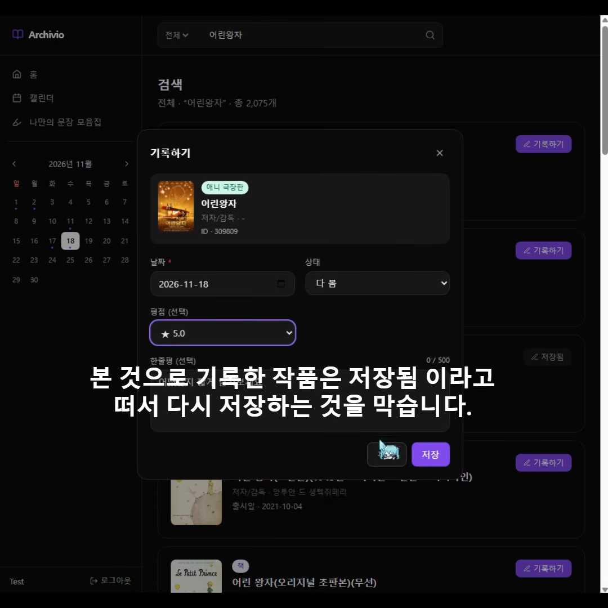
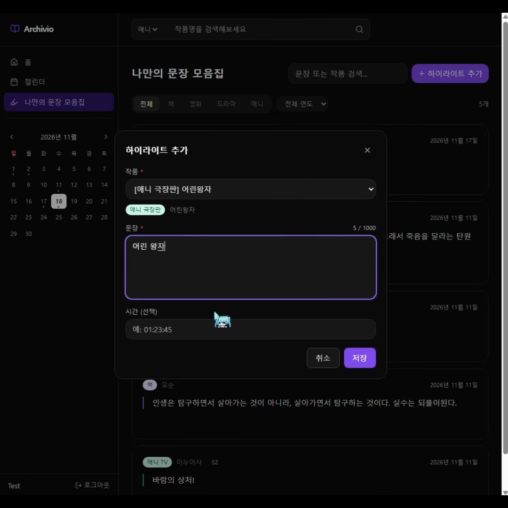
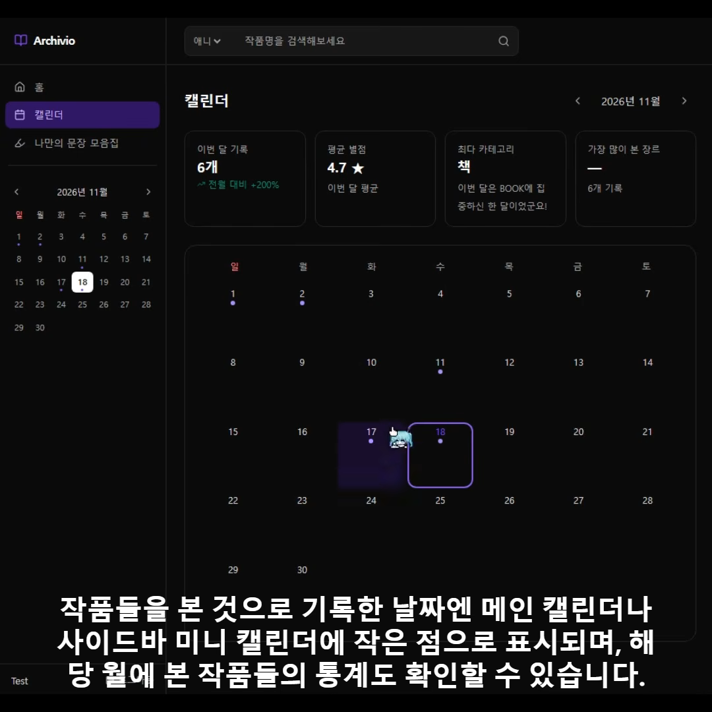
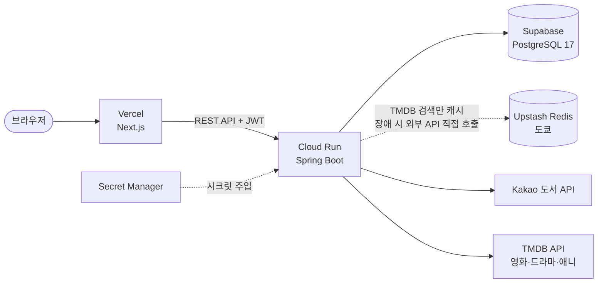

# book-log


책·영화·드라마·애니를 검색해 기록하고, 하이라이트와 캘린더·월간 통계로 돌아보는 개인 기록 서비스입니다. 기획부터 백엔드·프론트·배포·CI까지 혼자 진행했습니다.

- 배포(프론트): https://book-log-seven.vercel.app/
- 데모 영상: https://www.youtube.com/shorts/2_c6pboGrXk
- GitHub: https://github.com/Eunseo-ee/book-log

> 백엔드는 Cloud Run `minScale=0`(비용 우선)이라 첫 요청에 콜드 스타트가 있습니다. 그래서 라이브 데모 대신 영상을 기본으로 둡니다.

| 1. 통합 검색 | 2. 기록 저장 |
| :---: | :---: |
|  |  |
| 책·영화·드라마·애니를 한 번에 검색 | 검색 결과를 내 기록으로 저장 |

| 3. 하이라이트 | 4. 캘린더·월별 통계 |
| :---: | :---: |
|  |  |
| 인상 깊은 문장을 남기고 모아 보기 | 한 달의 활동을 돌아보기 |

## 주요 기능

1. **통합 검색**: 책은 Kakao, 영화·드라마·애니는 TMDB로 검색합니다. 한쪽 API가 실패해도 나머지 결과를 반환합니다.
    -  **애니 검색:** TMDB의 `search/multi` 응답에서 장르 ID 16(애니메이션)이 포함된 영화는 `ANIME_MOVIE`, TV는 `ANIME_TVA`로 분류합니다. `category=ANIME`로 검색하면 두 분류를 모두 보여줍니다.
2. **기록**: 검색 결과를 내 기록으로 저장합니다. 같은 작품의 중복 저장은 DB 유니크 제약으로 막습니다.
3. **하이라이트 모음집**: 기록한 작품에 하이라이트를 남기고, 카테고리·연도로 모아 봅니다.
4. **미니 캘린더·월별 통계**: 기록한 날짜와 카테고리·평점·활동량을 월 단위로 보여줍니다.
5. **로그인**: JWT(access/refresh) 기반이며, 모든 조회·저장은 로그인한 사용자 기준으로만 동작합니다.

## 시스템 아키텍처



브라우저 → Vercel(Next.js) → Cloud Run(Spring Boot) → Supabase(PostgreSQL 17) / Upstash(Redis, 도쿄) / Kakao·TMDB API. 시크릿은 Secret Manager로 주입하고, 설정은 전부 환경변수입니다.

## 기술 스택

| 구분 | 기술 | 선택 이유 |
| --- | --- | --- |
| 백엔드 | Java 21, Spring Boot 3.4, Spring Security, JPA | 써 본 스택이라 학습보다 설계·검증에 시간을 쓸 수 있음 |
| 인증 | JWT(access/refresh 분리), BCrypt | Cloud Run은 인스턴스가 늘고 줄어 서버 세션 없이 STATELESS로 인증 |
| DB | PostgreSQL 17 (Supabase) | 월별 집계·날짜 범위 같은 통계 쿼리가 많고, 관리형이라 운영 부담이 적음 |
| 캐시 | Redis (Upstash) | 측정 후 TMDB에만 적용(아래 1번) |
| 테스트 | JUnit5, Testcontainers, spring-security-test | 네이티브 쿼리가 PostgreSQL 전용이라 실제 PostgreSQL로도 검증 |
| 배포 | Docker, GCP Cloud Run, GitHub Actions | 컨테이너를 그대로 배포, 트래픽이 없으면 0으로 줄어 비용이 거의 안 듦 |
| 프론트 | Next.js, React, TypeScript, Tailwind | 백엔드가 중심이라 빠르게 만들 수 있는 스택 |

## 핵심 설계·성능 하이라이트

측정 원본은 [docs/MEASUREMENTS.md](docs/MEASUREMENTS.md), 설계 결정은 [docs/DESIGN.md](docs/DESIGN.md)에 있습니다.

### 1. Redis 캐싱: 측정 후 TMDB에만 적용

- **문제:** 해외 API(TMDB)가 느려 캐싱을 검토했지만, 캐시가 항상 빠르다고 가정할 수 없었습니다.
- **선택:** 캐싱 없음/미스/히트를 직접 재고 TMDB에만 적용했습니다. TTL 10분, 빈 결과는 캐시하지 않습니다.
- **측정 (로컬 PC → Upstash 도쿄, 검색어 5건 각 1회):** TMDB 234.4ms → 43.2ms, Kakao 26.6ms → 44.6ms(원본이 빨라 왕복 시간이 더 커서 적용 안 함).
- **측정 (배포 환경 Cloud Run, `httpRequest.latency`, 검색어 5개를 각각 연속 2회):** 미스 중앙값 342ms → 히트 중앙값 88ms. 카테고리 ALL이라 캐시하지 않는 Kakao 요청을 포함한 값입니다.
- 두 측정은 환경과 대상이 다르고 표본이 작아, 절대 수치보다 경향으로 봐야 합니다.

### 2. 월별 조회: `TO_CHAR` → 날짜 범위 쿼리

- **문제:** 월별 캘린더·통계가 `TO_CHAR(view_date, 'YYYY-MM')`으로 조회했습니다.
- **선택:** 컬럼에 함수를 씌우지 않고 `[월 시작일, 다음 달 시작일)` 범위 조건으로 바꿨습니다. `(member_id, view_date)` 인덱스를 함께 사용합니다.
- **측정 (로컬 PostgreSQL 17, 10만 건):** 함수 조건에서는 인덱스가 `member_id`만 사용하고 날짜는 `Filter`로 처리돼 힙 2,000페이지를 읽었고, 범위 조건에서는 `view_date`까지 `Index Cond`가 되어 65페이지를 읽었습니다.
- "함수를 쓰면 인덱스를 못 탄다"는 처음 가설은 이 구성에서는 틀렸고, 측정으로 확인했습니다. 운영 DB 데이터는 현재 1행이라 "10만 건이 되었을 때"를 가정한 값입니다.

### 3. 캐시가 조용히 죽어 있던 운영 장애

- **문제:** 배포 후 검색은 정상이었지만 Upstash에 키가 없고 Commands가 0이었습니다. 캐시 오류를 삼키는 fail-open 설계가 장애를 가리고 있었습니다.
- **원인:** 스택트레이스를 임시로 켜 확인한 결과 `WRONGPASS`. Secret Manager의 비밀번호가 Upstash의 현재 값과 달랐습니다.
- **해결·검증:** 시크릿을 재등록해 배포했고, 키 생성과 TTL 감소를 확인했습니다. 이후 임시 스택트레이스 로깅은 검색어를 남기지 않는 마스킹 핸들러로 교체했습니다.
- **배운 점:** 오류를 삼키는 설계는 서비스를 지키지만 장애를 숨깁니다. WARN 한 줄은 "ERROR 로그 없음" 점검에 걸리지 않으므로, 캐시는 키·TTL·응답 시간으로 실제 동작을 확인해야 합니다.

## API 요약

운영에서는 Swagger가 꺼져 있어(로컬 비운영 프로파일에서만 `/swagger-ui/index.html`) 요약을 둡니다. `/api/auth/**`와 헬스체크를 제외한 모든 경로는 `Authorization: Bearer <access token>`이 필요합니다.

| 영역 | 메서드·경로 | 인증 | 설명 |
| --- | --- | --- | --- |
| 인증 | `POST /api/auth/register`, `/login`, `/refresh` | 불필요 | 가입(201), 로그인, access 재발급. 로그인 실패 메시지는 통일 |
| 검색 | `GET /api/search?category=&query=&page=` | 필요 | 카테고리 `BOOK` `MOVIE` `TV` `ANIME` `ANIME_MOVIE` `ANIME_TVA` `ALL`. 결과마다 `isSaved` 포함 |
| 콘텐츠 | `POST /api/contents` | 필요 | 기록 저장(201 + Location). 중복은 400 |
| | `GET /api/contents/check`, `/filter` | 필요 | 저장 여부 확인, 조건별 목록 |
| 하이라이트 | `GET`·`POST /api/highlights` | 필요 | 모음집 조회, 저장(201 + Location) |
| | `PUT`·`DELETE /api/highlights/{id}` | 필요 | 소유자만 가능(남의 것 403, 없는 id 404) |
| 캘린더 | `GET /api/calendar/activities?year=&month=` | 필요 | 월별 기록 있는 날짜. 범위 밖 값은 400 |
| 통계 | `GET /api/statistics?year=&month=` | 필요 | 월별 통계. 연·월 생략 시 현재(KST) |
| 헬스 | `GET /actuator/health`, `/health/liveness`, `/health/readiness` | 불필요 | status만 노출 |

## 로컬 실행

<details>
<summary>펼쳐서 보기</summary>

필요한 것: JDK 21, Docker(로컬 DB·Redis용), Node.js(프론트).

설정 파일(`application.yml`, `application-api-key.yml`)은 gitignore 대상이라 레포에 없고, **환경변수만으로 기동**합니다. 아래 순서는 깨끗한 `git archive` 사본에서 실제로 따라 해 기동과 요청까지 확인했습니다.

**1) DB·Redis**

```bash
docker run -d --name bl-pg -e POSTGRES_PASSWORD='<임의의 비밀번호>' -e POSTGRES_DB=booklog -p 5432:5432 postgres:17-alpine
docker run -d --name bl-redis -p 6379:6379 redis:7-alpine
```

Redis가 없어도 기동과 검색은 되지만(캐시 오류는 삼키고 외부 API를 직접 호출), 캐시는 동작하지 않습니다.

**2) 환경변수** — [.env.example](.env.example)을 참고해 채웁니다. 시크릿 값은 커밋하지 않습니다.

| 변수 | 필수 | 로컬 예시 / 설명 |
| --- | --- | --- |
| `SPRING_DATASOURCE_URL` | ✅ | `jdbc:postgresql://localhost:5432/booklog` |
| `SPRING_DATASOURCE_USERNAME`, `_PASSWORD` | ✅ | 위 컨테이너 기준 `postgres` / 위에서 정한 `<임의의 비밀번호>` |
| `SPRING_JPA_HIBERNATE_DDL_AUTO` | 빈 DB면 ✅ | 빈 DB는 `update`로 테이블 생성. 운영은 `validate` |
| `API_KAKAOKEY` | ✅ | Kakao REST API 키. 비어 있으면 기동 실패 |
| `API_TMDBTOKEN` | ✅ | TMDB 읽기 토큰. 비어 있으면 기동 실패 |
| `JWT_SECRET` | ✅ | BASE64, 디코딩 후 32바이트 이상. 예: `openssl rand -base64 48` |
| `JWT_ACCESSTOKENEXPIRATION`, `JWT_REFRESHTOKENEXPIRATION` | ✅ | 밀리초. 예: `900000`, `604800000` |
| `SPRING_DATA_REDIS_HOST`, `_PORT` | 권장 | `localhost` / `6379`. Upstash는 `_PASSWORD`, `_SSL_ENABLED=true`도 필요 |
| `APP_CORS_ALLOWED_ORIGINS` | 선택 | 비면 `http://localhost:3000`만 허용. 쉼표로 여러 개, `*` 불가 |
| `SPRING_PROFILES_ACTIVE` | 선택 | 로컬은 비워 둠. `prod`이면 CORS 값이 필수이고 Swagger가 꺼짐 |

**3) 백엔드** (`demo/`에서 실행, 기본 포트 8080)

```bash
cd demo
./gradlew bootRun          # Windows: gradlew.bat bootRun
```

확인: `GET http://localhost:8080/actuator/health` → `{"status":"UP",...}`

**4) 프론트** (`frontend/`, 기본 포트 3000)

```bash
cd frontend
npm install
NEXT_PUBLIC_API_URL=http://localhost:8080 npm run dev   # 또는 .env.local에 같은 값을 넣기
```

`NEXT_PUBLIC_API_URL`은 빌드 시점에 번들에 박히므로 시크릿을 넣지 않습니다. production 빌드에서는 필수입니다.

**검증 범위:** 백엔드는 위 환경변수만으로 기동하고, 가입·로그인·인증 필요 API·검색(더미 키라 빈 결과)·헬스체크·Swagger를 확인했습니다. 프론트는 `next dev` 기동과 `/`, `/login`, `/search` 응답(200)까지 확인했습니다.

Docker 이미지로 띄울 때는 이미지 기본 프로파일이 `prod`라 `APP_CORS_ALLOWED_ORIGINS`가 필요합니다(없으면 기동 실패).

</details>

## 테스트 / CI / 배포

- **테스트:** `cd demo && ./gradlew test` → 372개 실행, skipped 0, failures 0, errors 0. 사용자 A/B 격리, 인증 필요 API, 토큰 종류 구분, 예외 응답 상태 코드, 실제 PostgreSQL(Testcontainers) 대상 Repository 테스트를 포함합니다. 일반 DB 테스트는 임베디드 H2(test 프로파일)로 돌아 실DB에 붙지 않습니다.
- **CI:** GitHub Actions가 push/PR마다 테스트를 실행합니다. Testcontainers 테스트가 skip되거나 결과가 없으면 CI를 실패시키는 가드가 있습니다(과거에 9개가 조용히 skip된 적이 있어서).
- **배포:** 멀티스테이지 Dockerfile(비 root, 설정은 전부 환경변수) → Cloud Run. 프론트는 Vercel. 운영에서는 Swagger 비활성, actuator는 health만 노출, liveness/readiness 분리. 배포 후 스모크 테스트(헬스, 가입/로그인, 검색, 저장, 캘린더, CORS, 로그)를 합니다.

## 한계와 다음 단계

- 사이드바 미니 캘린더가 저장 직후 갱신되지 않습니다. 현재 새로고침해야 적용됩니다(프론트).
- 검색이 전부 실패한 경우와 결과가 없는 경우를 프론트가 구분하지 못합니다(응답/에러 규약 개선 예정).
- 일부 에러 로그에 사용자 검색어가 남는 문제를 검토 중입니다.
- refresh 토큰을 서버가 저장하지 않아 탈취돼도 폐기할 수 없습니다. 서버 측 폐기와 httpOnly 쿠키 전환이 예정돼 있습니다.
- 로그인 시도 횟수 제한, 하이라이트 단건 조회 API(저장 응답의 `Location`이 가리키는 GET이 아직 없음), 이미지 업로드, 공개 범위, 하이라이트 키워드 검색, Redis 비동기 처리.

## 상세 문서

- [docs/DESIGN.md](docs/DESIGN.md): 설계 결정과 트레이드오프
- [docs/MEASUREMENTS.md](docs/MEASUREMENTS.md): 성능 측정 원본(검색어별 값, 측정 조건·한계)
- [docs/TROUBLESHOOTING.md](docs/TROUBLESHOOTING.md): 문제 해결 기록 ①~⑨

개발은 Phase/task 단위로 나눠 진행했고, 각 task에 완료 기준과 트레이드오프를 문서화했습니다(`.claude/tasks/`). 구현은 AI 코딩 도구와 함께 했으며, 요구사항 정의·설계 결정·테스트와 측정을 통한 검증은 직접 했습니다.
